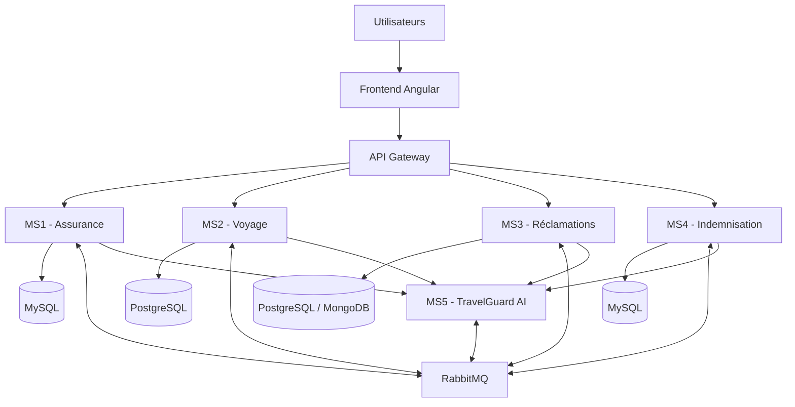

# TravelGuard — Plateforme intelligente de gestion des assurances voyage

<p align="center">
  <strong>Une plateforme intelligente pour simplifier et optimiser la gestion des assurances voyage.</strong>
</p>

---

## Présentation du projet

**TravelGuard** est une plateforme web intelligente basée sur une architecture microservices. Elle permet de centraliser la gestion des assurances voyage, le suivi des déplacements, le traitement des sinistres et la gestion des indemnisations.

Grâce à l'intégration de l'intelligence artificielle, TravelGuard propose également des fonctionnalités avancées d'analyse des risques, de recommandation d'assurances et de détection des réclamations potentiellement frauduleuses.

### Problématique

Comment concevoir une plateforme intelligente et distribuée permettant de centraliser la gestion des assurances voyage, d'automatiser le traitement des sinistres et des indemnisations et d'améliorer la fiabilité des décisions grâce à l'intelligence artificielle ?

### Objectifs

- Centraliser la gestion des contrats et des garanties d'assurance.
- Faciliter l'enregistrement et le suivi des voyages.
- Simplifier la déclaration et le traitement des sinistres.
- Automatiser le calcul des indemnisations.
- Exploiter l'intelligence artificielle pour analyser les risques et détecter les anomalies.
- Garantir une architecture évolutive, modulaire et indépendante.

---

## Architecture du projet

TravelGuard repose sur cinq microservices indépendants, chacun responsable d'un domaine fonctionnel précis.

| Microservice | Responsabilité |
|---|---|
| **MS1 — Assurance** | Gestion des contrats, produits, garanties, exclusions et tarification. |
| **MS2 — Voyage** | Gestion des voyageurs, destinations, itinéraires et documents de voyage. |
| **MS3 — Réclamations** | Déclaration, suivi, analyse et traitement des sinistres. |
| **MS4 — Indemnisation** | Calcul des compensations, validation et suivi des paiements. |
| **MS5 — TravelGuard AI** | Analyse des risques, recommandations, détection de fraude et prédictions financières. |

### Architecture générale



### Parcours fonctionnel principal

1. Le voyageur souscrit à un contrat d'assurance.
2. Le service Assurance crée le contrat.
3. Le voyageur enregistre son voyage auprès du service Voyage.
4. Un incident survient pendant le voyage.
5. Le voyageur déclare un sinistre auprès du service Réclamations.
6. Le service Assurance vérifie les garanties applicables.
7. TravelGuard AI analyse les risques et les éventuelles anomalies.
8. Le gestionnaire examine le dossier et prend une décision.
9. Si le dossier est approuvé, le service Indemnisation calcule la compensation.
10. Le paiement est traité et le voyageur peut suivre son dossier.

---

## Technologies utilisées

### Backend
- Java
- Spring Boot
- Spring Cloud
- Spring Cloud Gateway
- Spring Cloud Netflix Eureka
- Spring Cloud Config
- OpenFeign

### Frontend
- Angular
- TypeScript
- HTML5 / CSS3

### Intelligence artificielle
- Python
- FastAPI
- Scikit-learn
- Pandas
- NumPy
- XGBoost

### Communication et infrastructure
- RabbitMQ
- Docker
- Docker Compose
- Keycloak

### Bases de données
- MySQL
- PostgreSQL
- MongoDB (selon les choix d'implémentation)

---

## Structure du repository

```text
TravelGuard/
│
├── Backend/
│   ├── ms-assurance/
│   ├── ms-voyage/
│   ├── ms-reclamations/
│   ├── ms-indemnisation/
│   ├── ms-ai/
│   ├── api-gateway/
│   ├── eureka-server/
│   └── config-server/
│
├── Frontend/
│   └── travelguard-angular/
│
├── Infrastructure/
│   ├── docker-compose.yml
│   ├── rabbitmq/
│   ├── keycloak/
│   └── configuration/
│
├── Documentation/
│   ├── Presentation/
│   ├── Diagrams/
│   ├── API/
│   └── Dossier_Technique.docx
│
└── README.md
```

---

## Communication entre microservices

TravelGuard utilise deux mécanismes de communication complémentaires.

### Communication synchrone — REST / OpenFeign

Utilisée lorsqu'un microservice a besoin d'une réponse immédiate d'un autre service.

Exemple : le service Voyage contacte le service Assurance afin de vérifier la validité d'un contrat avant d'enregistrer un déplacement.

### Communication asynchrone — RabbitMQ

Utilisée pour transmettre des événements métier sans bloquer le service émetteur.

Principaux événements :

| Événement | Émetteur | Destinataire |
|---|---|---|
| `ContractCreated` | Assurance | Voyage, IA |
| `TravelRegistered` | Voyage | IA |
| `ClaimSubmitted` | Réclamations | Assurance, IA |
| `CoverageVerified` | Assurance | Réclamations |
| `FraudAnalysisCompleted` | IA | Réclamations |
| `ClaimApproved` | Réclamations | Indemnisation |
| `CompensationCreated` | Indemnisation | Réclamations |
| `PaymentCompleted` | Indemnisation | Réclamations |

---

## Fonctionnalités intelligentes

TravelGuard AI apporte une couche d'intelligence aux différents services métier.

| Fonctionnalité | Description |
|---|---|
| Analyse des risques | Évaluation des risques associés aux destinations. |
| Recommandation d'assurance | Suggestion d'une formule adaptée au profil du voyageur. |
| Détection de fraude | Identification des réclamations présentant des anomalies. |
| Estimation de gravité | Évaluation de la gravité potentielle d'un sinistre. |
| Prévisions financières | Estimation des dépenses et des coûts associés. |

Les résultats de l'IA constituent une aide à la décision. Les décisions administratives d'approbation ou de rejet restent sous la responsabilité du gestionnaire.

---

## Installation et lancement

### Prérequis

Avant de commencer, assurez-vous de disposer des outils suivants :

- Git
- JDK compatible avec la version de Spring Boot utilisée.
- Maven
- Node.js et npm
- Python
- Docker et Docker Compose
- Les systèmes de gestion de bases de données nécessaires.

### 1. Cloner le repository

```bash
git clone <URL_DU_REPOSITORY>
cd TravelGuard
```

### 2. Lancer l'infrastructure

```bash
docker compose -f Infrastructure/docker-compose.yml up -d
```

Cette commande permet de démarrer les composants d'infrastructure configurés dans Docker Compose.

### 3. Lancer les microservices Spring Boot

Dans chaque dossier de microservice :

```bash
mvn clean install
mvn spring-boot:run
```

### 4. Lancer le microservice IA

Dans le dossier `Backend/ms-ai/` :

```bash
python -m venv venv
```

Activation de l'environnement virtuel :

**Windows :**
```bash
venv\Scripts\activate
```

**Linux / macOS :**
```bash
source venv/bin/activate
```

Installation des dépendances :

```bash
pip install -r requirements.txt
```

Lancement de l'application :

```bash
uvicorn main:app --reload
```

### 5. Lancer le frontend

Dans le dossier `Frontend/travelguard-angular/` :

```bash
npm install
ng serve
```

L'application sera accessible à l'adresse locale indiquée par Angular CLI.

> **Remarque :** les commandes, ports, variables d'environnement et fichiers de configuration seront ajustés selon l'implémentation finale du projet.

---

## Organisation du travail avec Git

Pour faciliter la collaboration, le projet utilise une stratégie de branches organisée.

### Branches principales

| Branche | Utilisation |
|---|---|
| `main` | Version stable du projet. |
| `develop` | Branche principale de développement. |

### Branches de fonctionnalités

```text
feature/ms-assurance
feature/ms-voyage
feature/ms-reclamations
feature/ms-indemnisation
feature/ms-ai
feature/frontend
feature/infrastructure
```

### Convention de commits

Utilisez des messages de commit explicites et cohérents :

```bash
feat: ajout de la gestion des contrats
fix: correction de la validation des garanties
refactor: amélioration de la structure du service
docs: mise à jour de la documentation
test: ajout des tests unitaires
chore: configuration de Docker
```

### Workflow de collaboration

1. Récupérer les dernières modifications de `develop`.
2. Créer une branche dédiée à la fonctionnalité.
3. Développer et tester les modifications.
4. Effectuer des commits explicites.
5. Ouvrir une Pull Request vers `develop`.
6. Faire vérifier les modifications avant leur fusion.

---

## Documentation

La documentation technique du projet comprend :

- Diagrammes de cas d'utilisation.
- Diagrammes de classes.
- Diagrammes d'architecture.
- Diagrammes de séquence.
- Documentation des API REST.
- Description des événements RabbitMQ.
- Documentation des bases de données.
- Guide d'installation et de déploiement.

Les documents sont disponibles dans le dossier `Documentation/`.

---

## Équipe de développement

**Projet académique — Architecture Microservices**

Équipe : Pioneer

Membres :
- Raghed Selmi
- yasmine Jbeli
- Aziz Akrout
- Jasser Missaoui

Établissement : **Esprit — École Supérieure Privée d'Ingénierie et de Technologies**

---

## Licence

Projet développé dans le cadre d'un projet académique.

Tous droits réservés aux membres de l'équipe de développement.
